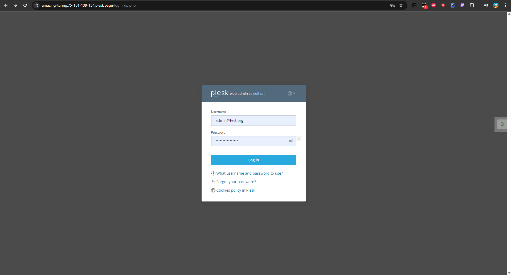
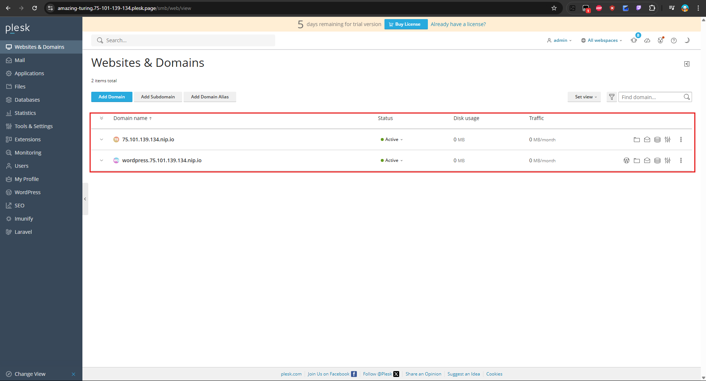
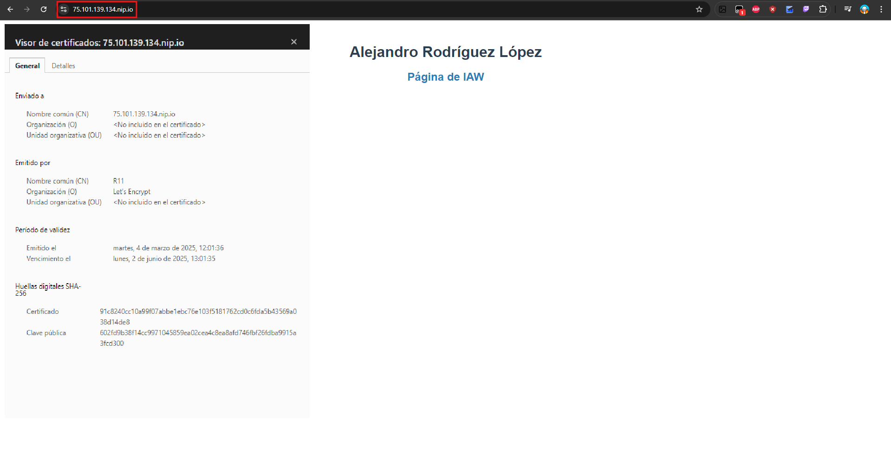
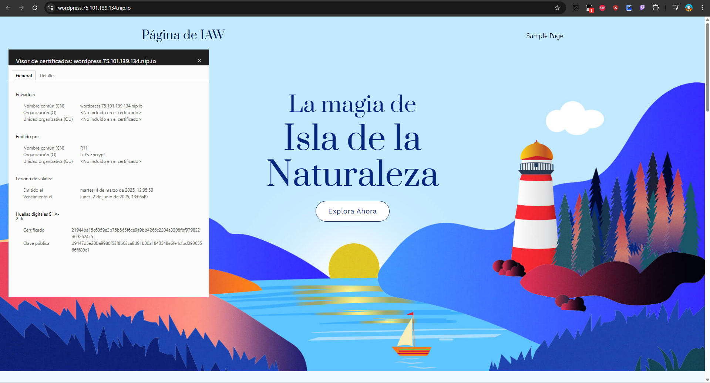

# Practica-IAW-Plesk- Despliegue de aplicaciones web con Plesk.

## 1. Instalación de Plesk en una instancia EC2 de AWS.

Pues para instalarlo, simplemente ejecutamos el script `install_plesk.sh` que tendremos que crear en nuestro directorio. Los comandos que componen el archivo `install_plesk.sh` son los siguientes:

```bash
#!/bin/bash
set -ex

# Descargamos el script de instalación de Plesk
wget https://autoinstall.plesk.com/plesk-installer

# Le asignamos permisos de ejecucion al script 
chmod +x plesk-installer 

# Ejecutamos el script de instalación
./plesk-installer install plesk
```

El proceso de instalación puede tardar unos **10 minutos**. Una vez que la instalación termine, aparecerá un mensaje similar como el que se muestra a continuación:

```bash
Congratulations!

The installation has been finished. Plesk is now running on your server.

To complete the configuration process, browse either of URLs:
   * https://frosty-antonelli.75-101-139-134.plesk.page/login?secret=rNECTAYl7gCSNhDCraxGuQD_ANbwMIeAP7JLtkUymSTChS5_
   * https://75-101-139-134/login?secret=rNECTAYl7gCSNhDCraxGuQD_ANbwMIeAP7JLtkUymSTChS5_

Use the username 'admin' to log in. To log in as 'admin', use the 'plesk login' command.
You can also log in as 'root' using your 'root' password.

Use the 'plesk' command to manage the server. Run 'plesk help' for more info.

Use the following commands to start and stop the Plesk web interface:
'systemctl start psa.service' and 'systemctl stop psa.service' respectively.

If you would like to migrate your subscriptions from other hosting panel
or older Plesk version to this server, please check out our assistance
options: https://www.plesk.com/professional-services/
```

Para completar el proceso de instalación habrá que acceder a una de las URLs que aparecen en el mensaje anterior. Como yo ya lo instalé, lo que me aparece es el login de plesk.




## 2. Subdominios creados




## 3. Página con un html creado y funcionando



## 4. Página con un wordpress desplegado y funcionando


